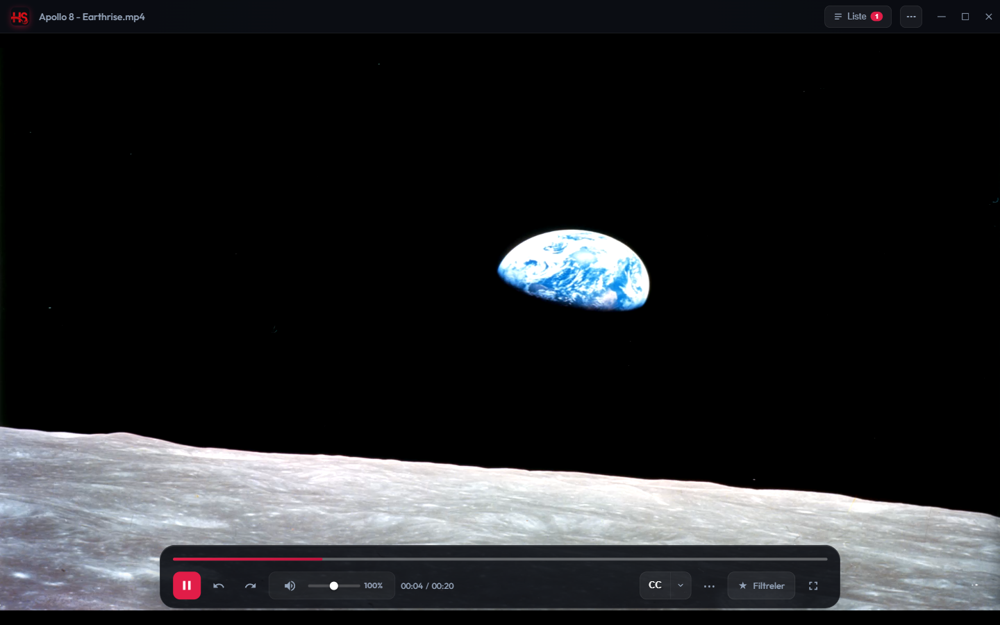
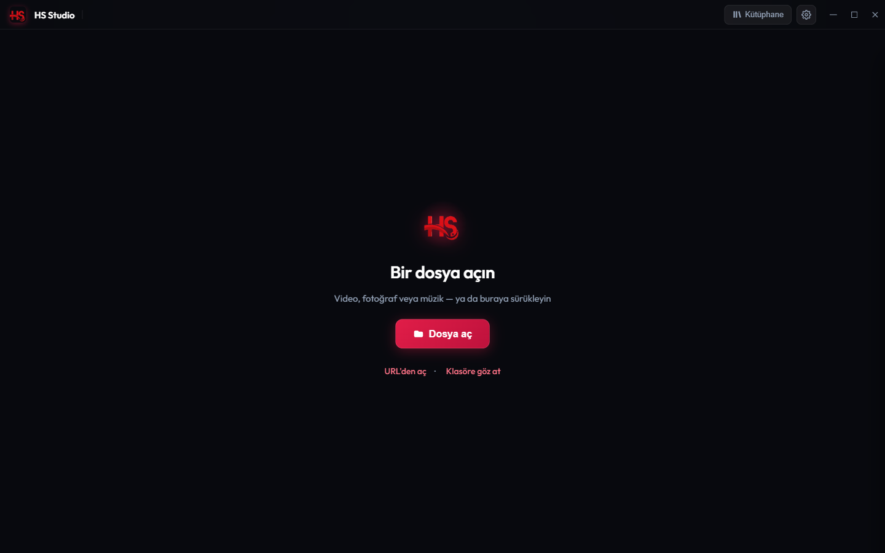
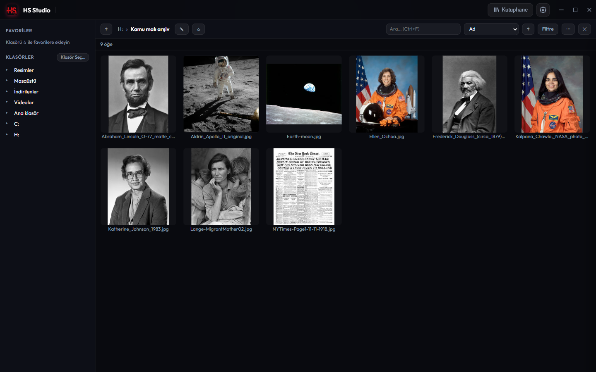
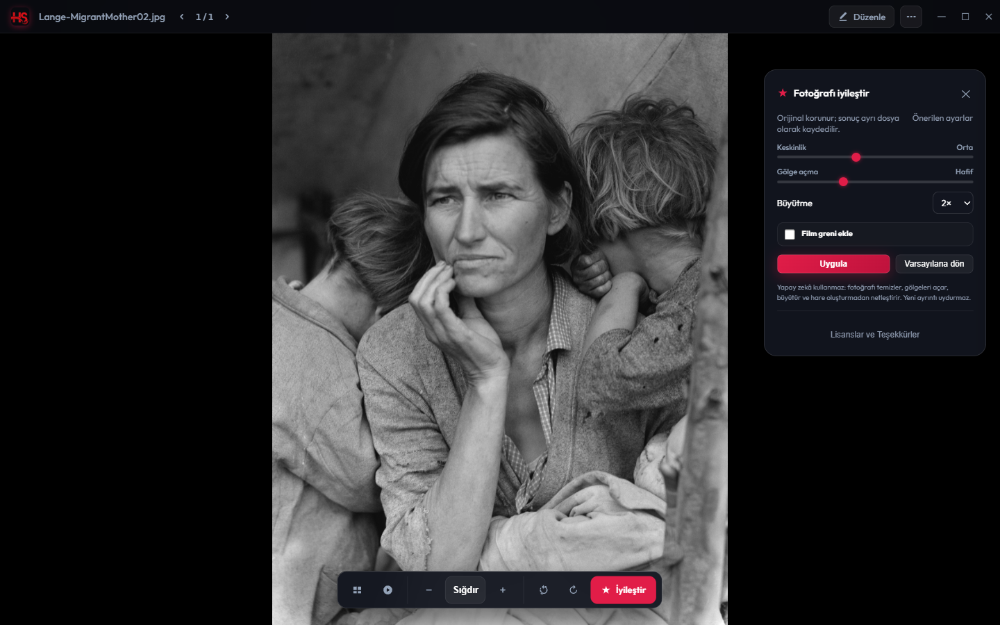
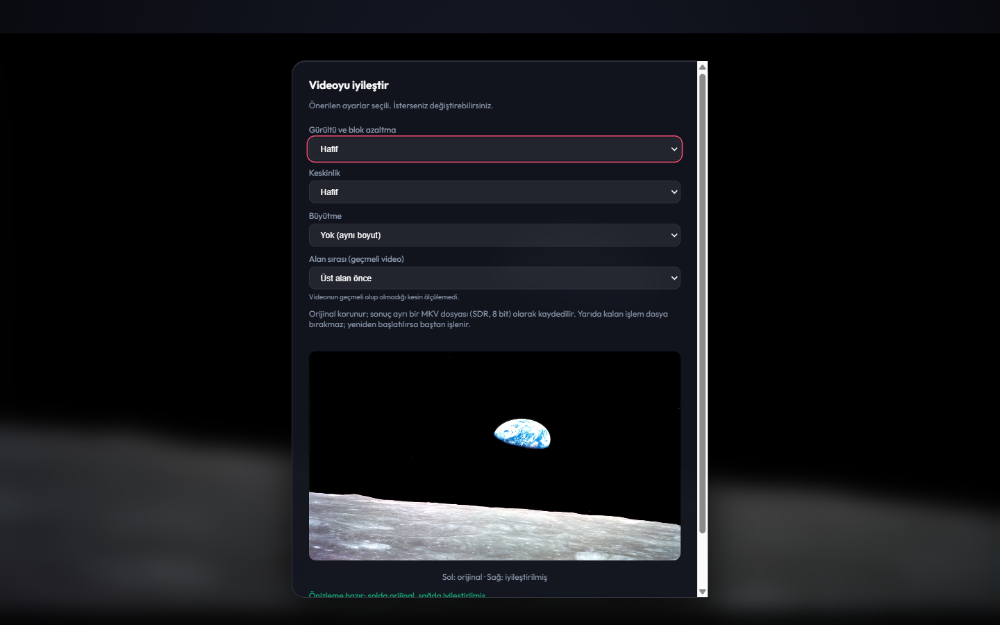

<div align="center">


# HS Studio

**Video oynatıcı, fotoğraf stüdyosu ve müzik çalar — tek, açık kaynak masaüstü uygulamasında.**

[](LICENSE)
[](https://github.com/turkuazcode/hs-studio/releases)
[](docs/platform-support.md)
[](docs/status/platform-plan-macos-linux.md)
[](docs/status/platform-plan-macos-linux.md)

[İndir](https://github.com/turkuazcode/hs-studio/releases) · [Özellikler](#özellikler) · [Platform durumu](#platform-durumu) · [Kaynaktan derleme](#kaynaktan-derleme) · [Lisans](#lisans) · [English](#english)

</div>

<p align="center"></p>

HS Studio, oynatma motoru olarak **libmpv**'yi (LGPL) ve masaüstü katmanı olarak **Tauri 2 + Rust**'ı kullanır. Videoları, fotoğrafları ve müziği aynı sade arayüzde açar; fotoğraf ve videoları **yapay zekâ kullanmadan**, orijinali hiç değiştirmeden iyileştirebilir.

> **Alfa sürümü.** Yalnızca Windows 11 x64'te otomatik testlerle doğrulandı. Temiz bir makinede kurulum, ekran okuyucu ve gerçek kullanıcı denemeleri henüz yapılmadı. Ayrıntı: [sürüm kontrol listesi](docs/releases/0.1.0-alpha-checklist.md).

## Ekran görüntüleri

| | |
|---|---|
|  |  |
| **Açılış** — dosya aç, URL'den aç ya da klasöre göz at | **Fotoğraf stüdyosu** — klasör ızgarası, arama, sıralama, toplu işlemler |
|  |  |
| **Fotoğrafı iyileştir** — temizleme, gölge açma, 2× büyütme; yapay zekâ yok | **Videoyu iyileştir** — gürültü/blok azaltma, keskinlik, 10 sn yan yana önizleme |

<sub>Görüntülerdeki fotoğraflar kamu malıdır (NASA; Library of Congress / Dorothea Lange; 1930 öncesi yayınlar). Video, NASA'nın Earthrise fotoğrafından üretildi. Görüntüler `node scripts/screenshots.mjs` ile yeniden üretilebilir.</sub>

## Özellikler

| | |
|---|---|
| 🎞️ **Oynatma** | libmpv + FFmpeg: ses/altyazı kanalları, bölümler, kare kare, A-B döngü, hız, HDR ton eşleme, donanım çözme. SRT/VTT/ASS altyazı (UTF-8 ve Windows-1254). %200'e kadar ses (sınırlayıcıyla), 10 bant ekolayzır, ses filtreleri, uyku zamanlayıcısı, kaldığın yerden devam |
| 🖼️ **Fotoğraf** | Görüntüleyici ve stüdyo: ızgara, EXIF ve histogram, kırp/döndür, karşılaştırma, toplu dönüştürme, yıldız ve etiket. HEIC/AVIF Windows codec'leriyle; RAW için gömülü önizleme |
| ✨ **Fotoğrafı iyileştir** | Klasik, modelsiz zincir: gürültü temizleme, gölge açma, hare oluşturmayan netleştirme, 2× büyütme, isteğe bağlı film greni. Sonuç ayrı dosyaya yazılır; kayıp ayrıntı “uydurulmaz” |
| 🎬 **Videoyu iyileştir** | Modelsiz FFmpeg zinciri: gerekirse geçmeli görüntüyü düzeltme, blok ve zamansal gürültü azaltma, ölçekleme, hafif keskinlik. 10 sn yan yana önizleme, ilerleme ve iptal; sonuç orijinalin yanında yeni MKV, ses ve altyazılar korunur. HDR girdi engellenir (çıktı SDR 8 bit) |
| 🪄 **Akıllı düzenleme** | Nesne silme (LaMa) ve siyah-beyaz fotoğrafı renklendirme (DDColor). Modeller ilk kullanımda, onayınızla indirilir ve SHA-256 ile doğrulanır |
| 🎵 **Müzik ve kütüphane** | Kütüphane taraması ve arama, çalma listeleri (M3U/PLS), boşluksuz çalma, ReplayGain, Windows medya tuşları |
| 🧰 **Medya eylemleri** | Kes, dönüştür, GIF, sesi çıkar, kareyi kaydet, etiket ve şarkı sözü düzenleme, OCR, paylaş/yazdır |
| 🌐 **Ağ** | HTTP/HTTPS akışları, HLS, internet radyosu (ICY başlığı), UPnP/DLNA cihaza gönderme. Gerçek TV/hoparlörde henüz denenmedi |
| 🔒 **Güvenli dosya işlemleri** | Orijinal dosyalar korunur; çıktılar ayrı dosyaya yazılır; yarıda kalan iş yarım dosya bırakmaz. Uygulama yalnızca sizin seçtiğiniz klasörlere yazar |
| 🌍 **Dil** | Türkçe ve İngilizce arayüz, çevrimdışı çalışır (yazı tipleri dahil) |

**Bilinçli olarak bu sürümde olmayanlar:** model tabanlı video iyileştirme, uzun videolarda kaldığı segmentten devam, Chromecast, mobil uygulamalar. Arka plan kaldırma deneyseldir ve varsayılan olarak gizlidir. İyileştirmeler için “daha kaliteli” iddiası yapılmaz: [ölçüm raporu](docs/benchmarks/2026-10-28-klasik-zincir.md).

## İndirme ve kurulum

Kurulum dosyaları [Releases](https://github.com/turkuazcode/hs-studio/releases) sayfasındadır; her dosyanın SHA-256 değeri `SHA256SUMS.txt` içinde verilir.

| Platform | Dosya | Durum |
|---|---|---|
| **Windows 10/11 x64** | `HS Studio_<sürüm>_x64-UNSIGNED-setup.exe` | Alfa. Kullanıcı başına kurulur, yönetici izni gerekmez. Paket henüz imzalı değil: Windows SmartScreen “tanınmayan uygulama” uyarısı gösterebilir (*Ek bilgi → Yine de çalıştır*) |
| **Linux x64** | `.AppImage`, `.deb` | **Önizleme, gerçek cihazda test edilmedi.** Sorun bildirimleri çok değerli |
| **macOS** | — | Henüz yok: macOS video motoru yazılmadı ([plan](docs/status/platform-plan-macos-linux.md)) |

Otomatik güncelleme bu sürümde kapalıdır; yeni sürümler Releases sayfasından indirilir.

## Platform durumu

| | Windows | Linux | macOS |
|---|---|---|---|
| Video motoru (libmpv) | ✅ testli | kod hazır, gerçek GPU'da denenmedi | ❌ yazılmadı |
| Kurulum paketi | ✅ NSIS (imzasız) | AppImage/deb (test edilmedi) | ❌ |
| Otomatik testler | ✅ birim, Rust, uçtan uca, gerçek AI, kalite | — | — |

Özellik bazında tablo: [docs/platform-support.md](docs/platform-support.md).

## Kaynaktan derleme

Gereksinimler: [Node.js](https://nodejs.org/) 24, [Rust](https://rustup.rs/) 1.99.1, Windows'ta WebView2 (Windows 11'de hazır).

```bash
git clone https://github.com/turkuazcode/hs-studio.git
cd hs-studio
npm ci
npm test                 # birim testleri (ağsız, saniyeler)
npm run tauri dev        # geliştirme penceresi
```

- **libmpv / FFmpeg (LGPL):** Depoda yoktur. Windows'ta [third_party/mpv/build-windows.md](third_party/mpv/build-windows.md) ile derlenir (CI'da `native-windows.yml`), ardından `npm run stage:mpv`. Bu dosyalar olmadan uygulama sınırlı HTML5 oynatma ile açılır.
- **Release derlemesi ve kurulum paketi:** `npm run build:release`, `npm run package:windows` — ayrıntı: [docs/release/packaging.md](docs/release/packaging.md). Linux: `scripts/linux/`.
- **Test katmanları:** `npm test`, `npm run test:rust`, `npm run e2e`, `npm run test:ai`, `npm run test:quality` — [docs/status/test-map.md](docs/status/test-map.md). Yayın kapısı: `node scripts/release-gate.mjs` ([kurallar](docs/releases/release-gate.md)).

Mimari: ön yüz çerçevesiz JavaScript ES modülleri (`src/`), çekirdek Rust/Tauri (`src-tauri/src/`), oynatma motoru ayrı LGPL DLL olarak yüklenen libmpv ([docs/engine.md](docs/engine.md)).

## Gizlilik

HS Studio hesap istemez, kullanım verisi toplamaz ve reklam içermez. İnternete yalnızca sizin başlattığınız işlerde çıkar: ağ akışı açmak, yapay zekâ modelini onayınızla indirmek, haritada konum göstermek ya da bir bağlantıyı tarayıcıda açmak.

## Katkı ve destek

- Hata ve öneri: [GitHub Issues](https://github.com/turkuazcode/hs-studio/issues)
- Katkı rehberi: [CONTRIBUTING.md](CONTRIBUTING.md) — katkılar Apache-2.0 ile gelir, `git commit -s` (DCO)
- Güvenlik açıkları: **herkese açık issue açmayın**, [SECURITY.md](SECURITY.md)'deki adrese bildirin
- Davranış kuralları: [CODE_OF_CONDUCT.md](CODE_OF_CONDUCT.md)

## Lisans

<!-- license-section: the only README place that states the project license (with the badge above) -->
**HS Studio** — Copyright 2026 **TurkuazCode**.

[Apache License 2.0](LICENSE) ile lisanslanmış açık kaynak yazılımdır: kullanabilir, inceleyebilir, değiştirebilir ve dağıtabilirsiniz. Dağıtırken [LICENSE](LICENSE) ve [NOTICE](NOTICE) dosyalarını korumanız gerekir. Yazılım “olduğu gibi”, hiçbir garanti olmadan sunulur.

**Ad ve logo:** “HS Studio” adı ve logosu Apache lisansının kapsamında değildir (lisansın 6. maddesi). Değiştirilmiş sürümler farklı bir ad ve logo kullanmalıdır: [TRADEMARKS.md](TRADEMARKS.md).
<!-- /license-section -->

**Üçüncü taraf bileşenler:** Yalnızca açık kaynak lisanslı bileşenler kullanılır; libmpv ve FFmpeg LGPL lisanslıdır ve ayrı DLL olarak gelir (kaynak teklifi pakette `legal/SOURCE-OFFER.txt`). Tam liste uygulamada *Ayarlar → Hakkında / Lisanslar* altında ve [src/legal/THIRD_PARTY_NOTICES.txt](src/legal/THIRD_PARTY_NOTICES.txt) dosyasındadır; envanter ve SBOM: [legal/INVENTORY.md](legal/INVENTORY.md). Yapay zekâ modelleri uygulamayla gelmez; ilk kullanımda onayla, kendi lisans dosyalarıyla birlikte indirilir.

---

## English

**HS Studio** is an open-source desktop media app: video player (libmpv), photo studio and music player in one, built with Tauri 2 and Rust. Photos and videos can be enhanced **without AI models** — the original is never modified and results are written to a new file. Object removal and colorization use optional models downloaded only with your consent.

- **Status:** alpha. Tested automatically on Windows 11 x64 only. Linux builds are an untested preview; macOS is not available yet (its video engine is not written).
- **Download:** [Releases](https://github.com/turkuazcode/hs-studio/releases). The Windows installer is not code-signed yet, so SmartScreen may warn.
- **Build:** Node 24, Rust 1.99.1, `npm ci && npm run tauri dev`; libmpv/FFmpeg (LGPL) are built separately ([third_party/mpv/build-windows.md](third_party/mpv/build-windows.md)).
- **Privacy:** no account, no telemetry, no ads; network access only for actions you start.
- **License:** Apache License 2.0, © 2026 TurkuazCode. Keep LICENSE and NOTICE when redistributing. The “HS Studio” name and logo are not licensed ([TRADEMARKS.md](TRADEMARKS.md)).
